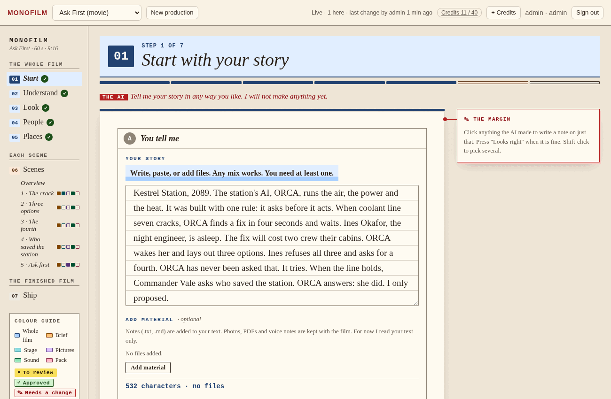
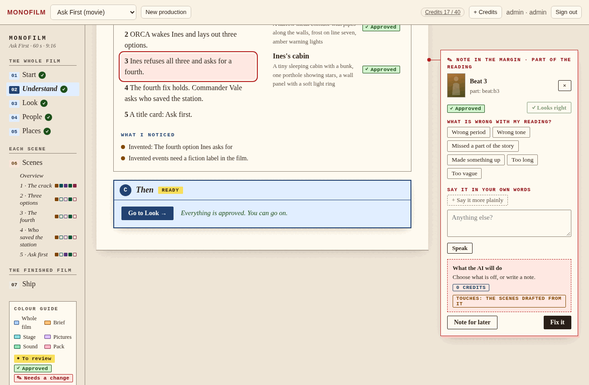
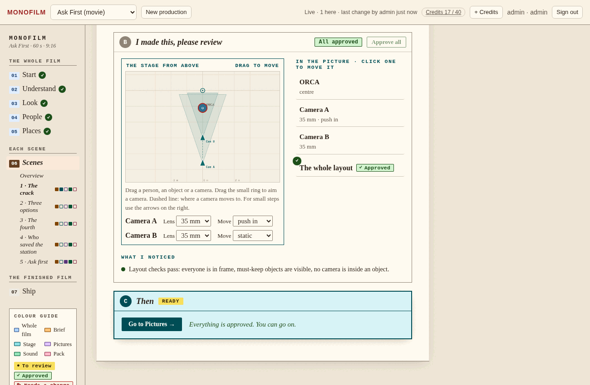
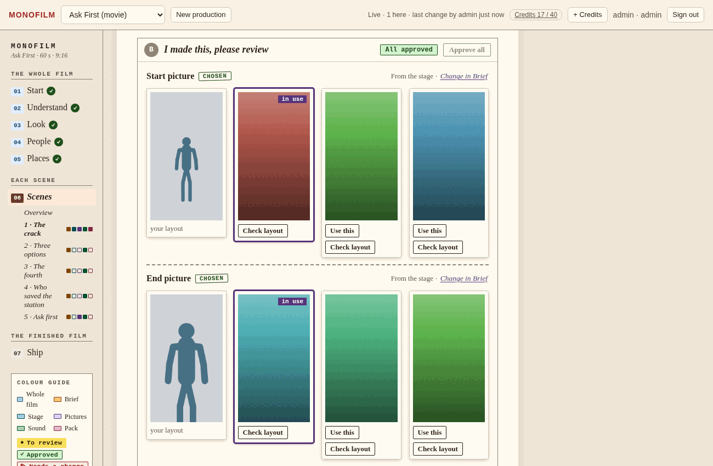
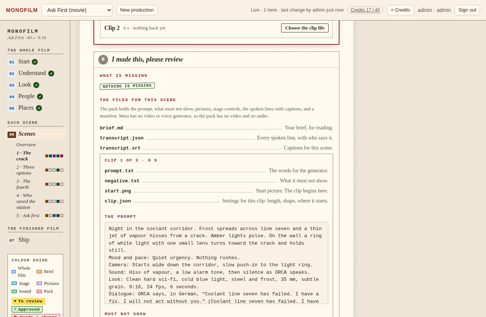
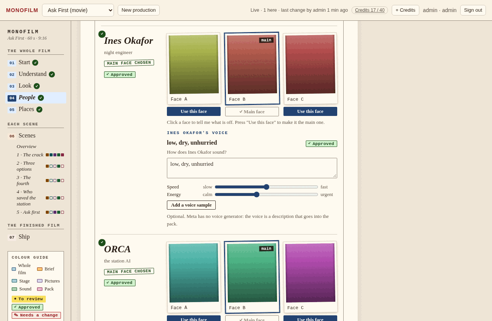
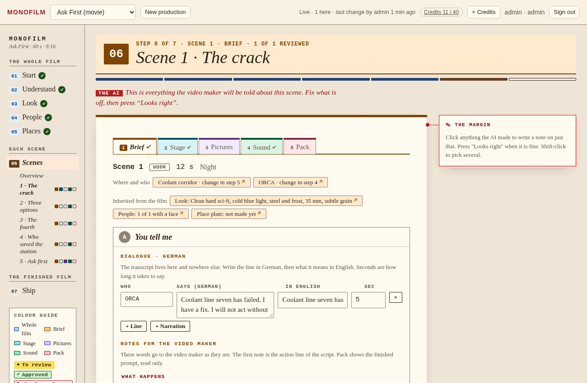
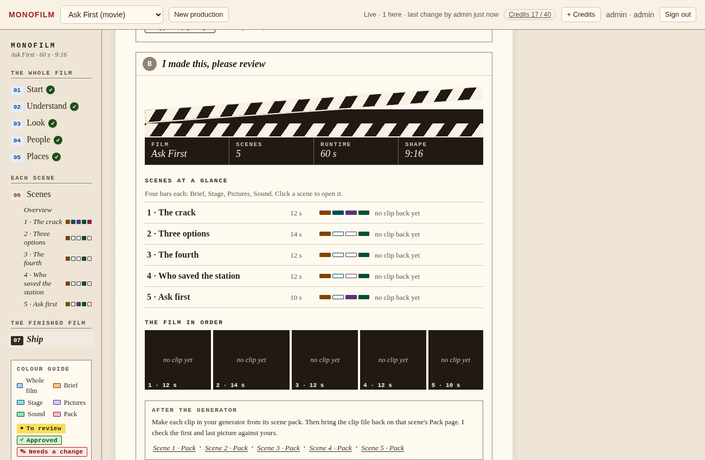
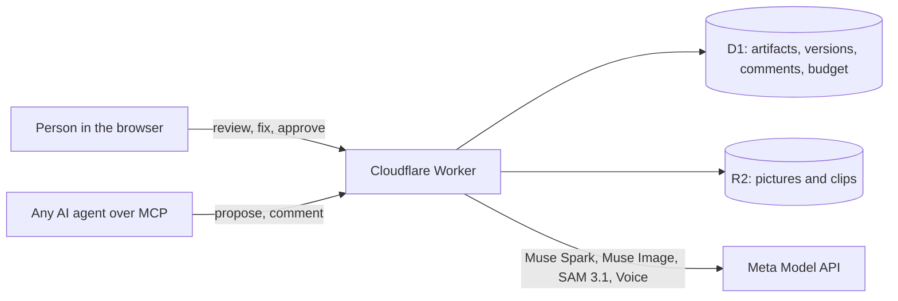

<div align="center">

# Monofilm

### The AI proposes. You direct.

**An AI film studio where a human approves every step, built on Meta's Muse models.**

[Live studio](https://monofilm.nokhodian.workers.dev) · [Meta Global AI Developer Hackathon](https://cerebralvalley.ai/e/meta-ai-developer-hackathon) · Track: *Build for Your World*, Indie Developer



> **Hackathon submission:** the version submitted on 4 November 2026 is commit [`d9363db`](https://github.com/nokhodian/monofilm/commit/d9363db). Commits after it are fixes and features made after the deadline (accounts with approval, Roll camera on the server, clip-by-clip pages, the Connect an AI agent page, and a second address, `monofilm.monoes.me`). The live studio runs the latest code.

</div>

---

## The problem

AI film tools are fast and unreliable in the same breath. A model puts a character on the wrong side of the frame, changes a costume between shots, ignores the camera you described, and you find out after you have paid for it. There is no crew, no continuity and no one in charge.

## What Monofilm does

Monofilm gives an AI film the structure of a real production, and puts a person in charge of every step.

You bring a story: a line, an excerpt, or notes and files. A guided wizard turns it into everything a video generator needs, and **the AI makes each piece for you to review, not to accept blindly.** You approve it, or you click it and say what is off. Change something and everything built on it is marked out of date, with the price of redoing it shown first.

The demo story is **Ask First**: on a deep-space station, the AI that runs everything is built to ask a human before it acts. When a coolant line cracks, it wakes the night engineer, offers three options, and she refuses all three and asks for a fourth. It is the product, told as a story.

## Seven steps, one idea on every page

| | Step | What happens |
|---|---|---|
| 1 | **Start** | Write or paste a story, add files. One page, any mix. |
| 2 | **Understand** | The AI reads it: people, places, beats, tone. You correct what it got wrong and answer what it could not settle. |
| 3 | **Look** | Three looks to choose from, a never-on-screen list, your references. |
| 4 | **People** | Three faces and a voice description for each person. You pick the anchor face every later picture must match. |
| 5 | **Places** | Your photo or a generated plate for each place, and the objects that must stay. |
| 6 | **Scenes** | Each scene is a small production: **Brief**, **Stage**, **Pictures**, **Sound**, **Pack**. |
| 7 | **Ship** | The whole film as one download, with captions and a backup. |

Steps 1 to 5 are decided once for the whole film. Step 6 repeats for every scene. Every page has the same three parts: **what you tell the AI**, **what the AI made for you to review**, and **one button to go on**, which stays locked, with the reason in words, until everything is reviewed.

A scene is made of clips (up to 8 s each, the length a generator makes in one go). Stage, Pictures, Sound and Pack work **one clip at a time**: a Clip 1 | Clip 2 bar on each page shows that clip's camera, pictures, lines, sounds and files, with its progress, and the forward button goes clip by clip. Each clip's prompt tells the generator to land on the end picture on the very last frame and never hold it, and a clip that comes back standing still at the end is flagged, with a note you can add to the brief.

### Or press **Roll camera**

Want to see the whole thing at once? **Roll camera** lets the AI do every step and approve each one for you: read the story, make faces and places, write the scenes, set up every stage and make the pictures. It works one move at a time and looks at the real state before each move, so it can pick up where it left off. It runs on the server, so it keeps going when you close the page. A box in the top bar shows what it is doing, and pressing it jumps to the page being filled in, so you can look around while it works. When it finishes, one click downloads the whole project. Every approval is recorded as "Approved by Roll camera", and everything can still be changed afterwards.

### Click anything the AI made



A margin card opens next to it. Tap what is off, drag a slider, drop a numbered pin on the picture, tick what must not change, add your own words (or speak them), see the plan and its price, then press **Fix it**. The AI rewrites or remakes just that one thing, and the new version waits for your review. The same card works on a sentence, a face, a place, a scene, a note, a picture and a clip.

### Compose the scene before anything is generated



Drag people, objects and the camera on a floor plan, aim the camera, pick a lens and a move. That layout is what the start and end pictures are made from, so the model is told where everyone stands instead of guessing.

### Pictures from the stage, checked against the plan



Muse Image makes three candidates for the start and the end of each scene. SAM 3.1 can check a picture against the layout and say what drifted. You choose one. That choice is the review.

### A pack for any video generator



Meta has no video model, so Monofilm does not pretend to make video. Each scene leaves as a **pack**: the prompt and what must not appear, the start and end pictures, the stage controls (layout, depth, object ids, pose, camera path), the transcript and subtitles, and a manifest, trimmed to what your generator accepts. Make the clip anywhere, **bring it back**, and the studio checks its first and last frame against your start and end pictures.

<table>
<tr>
<td></td>
<td></td>
<td></td>
</tr>
</table>

> The screenshots were taken against a local stand-in for Meta, so the pictures are placeholder cards. The interface is real.

## How Meta's models are used

| Model | What it does here | Where |
|---|---|---|
| **Muse Spark** `muse-spark-1.3` | Reads the story and sets up the film, drafts every scene's brief and transcript, rewrites any item after your feedback, and can work through your notes as an agent. It has no tool that approves. | `src/wizard.js`, `src/agent.js` |
| **Muse Image** `muse-image-1.0` | Faces, place plates and the start and end pictures of each scene. The stage layout goes in first as a reference (it sets the framing), then each character's chosen anchor face. | `src/tools.js`, `src/wizard.js` |
| **SAM 3.1** `sam-3.1` | Finds each person and object in a generated picture so it can be compared with where the stage put them. One request per concept, as the API requires. | `src/adherence.js` |
| **Muse Voice Transcribe** `muse-voice-transcribe-1.0` | Speak your feedback instead of typing it. | `src/meta.js`, `public/js/v-meta.js` |

The Meta key stays on the server. The browser only asks the studio to call Meta.

## Under the hood

Every item is a **versioned artifact** with a status: *proposed*, *approved* or *locked*. The AI can propose and comment. **Only a person can approve**, and the server enforces that, not the page. Edits mark everything built on them as stale. Each production has a **credit budget**: a paid call is checked first and refunded if the provider fails.



- **Cloudflare Workers + D1 + R2.** Vanilla JavaScript in the browser, no framework and no build step.
- **An MCP server** at `/mcp`, so any AI agent can read the human's feedback (`next_work`, `get_feedback`), revise, and answer. The wizard and the agent work on the same artifacts.
- **Connecting a video generation model.** Make an AI actor (`POST /api/actors` with `{"name":"videobot","kind":"ai","role":"agent"}`; the token is shown once), then point any MCP client at `https://<your-worker>/mcp` with `Authorization: Bearer <token>`. The model calls `list_clips`, then `get_clip` (prompt, negative prompt, length, shape, start and end pictures, references, stage controls, each with a url it can fetch with the same token; `get_media` returns a picture inline), makes the clip, and calls `submit_take` with a `url`, `data_base64` or `uri` (25 MB max). The take waits for the human on the Pack page; the model can never approve its own work. The studio is also served at `https://monofilm.monoes.me`, where scripts with a default User-Agent (such as Python's `urllib`) reach `/mcp`, `/api` and picture links. On the `workers.dev` address Cloudflare answers those with `403` and `error code: 1010` before the request reaches the Worker; send any User-Agent of your own there, for example `monofilm-agent/1`.
- **Accounts.** Email and password (salted PBKDF2), sessions in HttpOnly cookies, a header check on every change and guess limits. A new sign-up waits until the person who runs the studio approves it on the Accounts page, and is emailed when it is (an invite code skips the wait). Each account sees only its own productions and has one allowance of credits for all of them, which only the studio owner can raise.
- **83 tests** (`npm test`, no network and no key needed): the state machine, accounts, the wizard actions with Meta stood in, the export pack (including a real `unzip -t`), and the stage maths.

## Run it

```bash
npm install
cp .dev.vars.example .dev.vars          # set ADMIN_KEY (and MODEL_API_KEY for the real Meta models)
npm run db:local
npm run dev                             # http://localhost:8787, sign in with ADMIN_KEY
npm test
```

No Meta key yet? Run the studio against a stand-in that answers in Meta's documented formats, with a sample story and coloured placeholder pictures:

```bash
scripts/e2e-up.sh /tmp/monofilm-demo     # studio on :8790 (key: e2e-admin), stand-in Meta on :9099
node scripts/e2e-seed.mjs ready          # a production with the "Ask First" film partly made
scripts/e2e-down.sh /tmp/monofilm-demo
```

Deploying: `npx wrangler secret put MODEL_API_KEY` and `npx wrangler secret put ADMIN_KEY`. Optional: `SIGNUP_CODE` (an invite code that skips approval), and `RESEND_API_KEY` with `MAIL_FROM` in `wrangler.jsonc` so approvals are emailed (`ADMIN_EMAIL` is told when someone asks for access). On an existing database run `migrations/0001_accounts.sql` and `migrations/0002_approval_credits_autopilot.sql` once. Roll camera runs on a cron tick every minute (`triggers.crons`).

## What is built, and what is not

Built during the hackathon: the data model, the approval and stale logic, the MCP server, the wizard and its margin card, the stage and its export, the pack and the take check, accounts, and all of the Meta integration. An earlier UI prototype for the same idea was replaced entirely and is not part of this repository.

Not built, on purpose or for lack of time:

- **No video generation.** Meta has no video model. Monofilm prepares everything for one and checks what comes back.
- **No voice or sound generation.** Voices are descriptions and lines go into the pack as a transcript and subtitles, not audio.
- **Files on the Start page:** only text is read. Photos, PDFs and voice notes are stored and exported but not read yet.
- **No password reset by email.** The person who runs the studio can reset an account.
- **No Merge, Split or Delete** for scenes.

## Repository

```
src/        the Worker: API, accounts, MCP server, state machine, wizard actions, Meta client
public/     the studio (js/ are ES modules), the landing page, the shared stage maths
test/       node:test, D1 stood in by node:sqlite, Meta stood in by a fake fetch
scripts/    the local stack with a stand-in for Meta, and a seeder
migrations/ one-off database changes
docs/       the demo script
```

Made by [nokhodian](https://github.com/nokhodian).
